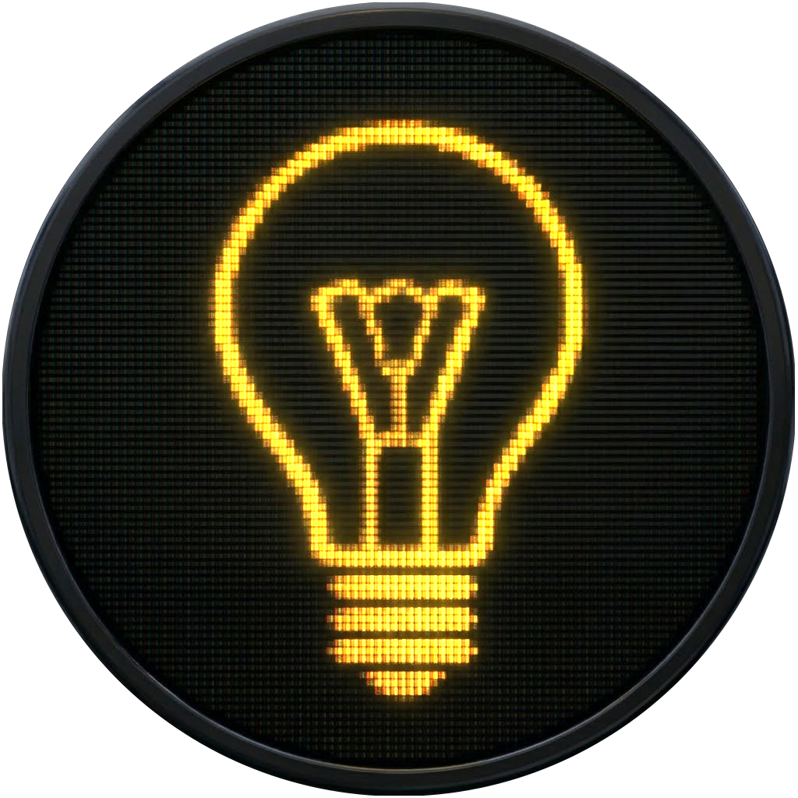

<p align="center"></p>

<h1 align="center">Lumen</h1>

<p align="center">
  <b>English</b> · <a href="#русский">Русский</a><br>
  Manual: <a href="manual/manual_EN.html">English</a> · <a href="manual/manual_RU.html">Русский</a>
</p>

---

## English

Open source remote access to work machines for small studios and teams. Connect to your work computer from home
or from another office and work as if you were sitting at it. The priority is stable and comfortable remote work:
sharp text, low latency, a picture that does not fall apart on a bad network.

### What it does

- **Video:** HEVC Main10 (4:2:0, 10 bit, BT.709 full range) encoded with NVENC on the work machine and decoded with
  NVDEC on yours, up to 4K at 60 fps. Static screen areas are refined until sharp; a per-session bitrate cap
  (Auto or 10…100 Mbit/s); recovery from packet loss without full keyframes (reference frame invalidation) and FEC.
- **Input and sound:** keyboard and mouse (system shortcuts go to the remote machine while the video window is in
  front; `Ctrl+Alt+Shift+Del` sends Ctrl+Alt+Del), sound from the remote machine.
- **Clipboard:** text both ways; pictures and files by Ctrl+C → Ctrl+V; big files go to `Downloads\Lumen`.
- **Monitors:** up to three monitors of the work machine, real or virtual; machines without a monitor get virtual
  ones through the [Lumen VDD](https://github.com/aimbyLeet/lumen-vdd) driver (included in the installer).
- **Login screen:** the host runs as a Windows service, so the machine is reachable on the sign-in and lock screens;
  after the session Windows locks itself.
- **Updates:** the apps update themselves from your server.

### How it works

```
  Lumen Client (your PC)  ◄────── video, input, sound, clipboard ──────►  Lumen Host (work machine)
            │                    directly over WireGuard / Tailscale                   │
            │                       end-to-end encrypted (Noise)                       │
            └──────── TLS ───────►  Lumen Server (VPS or LAN)  ◄──────── TLS ──────────┘
                           registration, access requests, sessions,
                           admin panel, download page, updates
```

- **Lumen Host** — on the work machine: a service plus a small window with the machine's token and settings.
- **Lumen Client** — on the computer you work from: a list of machines and a native video window.
  Host and client come from one installer, `lumen-setup-<version>.exe`; you choose the role while installing.
- **Lumen Server** — your team's own server: a VPS with a domain (in Docker, behind nginx with a Let's Encrypt
  certificate) or a machine on the local network (self-signed certificate trusted by its fingerprint). It registers
  devices, keeps the list of machines and who may connect to them, starts sessions and serves the admin panel
  (`/admin/`) and a download page at the domain root, from which the apps also take their updates.
  **Video never goes through the server.**
- **Network:** the client and the host talk directly over your own WireGuard or Tailscale network. Lumen has no relay
  and no NAT traversal of its own. The stream is encrypted end to end (Noise `IKpsk2`); its key comes from the host's
  token, which the server never sees.
- **Access:** devices register themselves; the first connection of a client to a machine is a request that an
  administrator approves in the admin panel. "Unlink" in the admin panel ends the session at once.

### Requirements

- Work machine and client: Windows 10/11 x64, NVIDIA GPU GTX 10xx or newer, NVIDIA driver 570 or newer.
- Server: a Linux VPS with Docker and a domain, or a Linux machine on the local network.
- A WireGuard or Tailscale network between the client and the work machines.

### Getting started

1. Download `lumen-setup-<version>.exe` and `lumen-server-<version>.tar.gz` from
   [Releases](https://github.com/aimbyLeet/lumen/releases).
2. Install the server — the quick start is at the top of the manual
   ([English](manual/manual_EN.html) · [Русский](manual/manual_RU.html)).
3. Install Lumen Host on the work machine, Lumen Client on yours, approve the request in the admin panel, connect.

The manual covers everything: the server (VPS or LAN, what lives where), the admin panel, the host, the client,
the first connection step by step, many machines, updates, maintenance and troubleshooting.

### Building from source

Windows 10/11, Rust stable (MSVC, see `rust-toolchain.toml`), Node.js, Inno Setup 6 (installer), Docker Desktop
(server archive), Visual Studio C++ tools.

```powershell
deploy\build-installer.ps1    # the UIs, the apps (release) and dist\lumen-setup-<version>.exe
deploy\build-server.ps1       # dist\lumen-server-<version>.tar.gz (after the installer)
```

The Lumen VDD driver comes prebuilt and signed in `third_party/lumen-vdd`; to build it yourself, see
[lumen-vdd](https://github.com/aimbyLeet/lumen-vdd). The code layout is in [docs/MAP.md](docs/MAP.md), the design
in [docs/architecture.md](docs/architecture.md), all commands in [docs/commands.md](docs/commands.md).

### License

MIT, see [LICENSE-MIT](LICENSE-MIT). Third-party parts keep their licenses: Opus (`crates/opus-sys/libopus`,
BSD-3-Clause), NVIDIA Video Codec SDK headers via FFmpeg nv-codec-headers (`crates/nvenc-sys/NOTICE`,
`crates/nvdec-sys/NOTICE`, MIT), Inter and JetBrains Mono fonts (SIL OFL 1.1), Lumen VDD (MIT).

---

## Русский

Open source удалённый доступ к рабочим машинам для небольших студий и команд. Подключайтесь к рабочему компьютеру
из дома или из другого офиса и работайте как за ним. Главное — стабильная и комфортная удалённая работа: чёткий
текст, низкая задержка, картинка, которая не разваливается на плохой сети.

### Что умеет

- **Видео:** HEVC Main10 (4:2:0, 10 бит, BT.709 full range) — кодирует NVENC на рабочей машине, декодирует NVDEC
  на вашей, до 4K и 60 кадров в секунду. Статичные области экрана дотягиваются до чёткости; потолок битрейта на
  сессию (Авто или 10…100 Мбит/с); восстановление после потерь без полных опорных кадров (инвалидация опорных
  кадров) и FEC.
- **Ввод и звук:** клавиатура и мышь (пока окно видео впереди, системные сочетания уходят на удалённую машину;
  `Ctrl+Alt+Shift+Del` отправляет Ctrl+Alt+Del), звук удалённой машины.
- **Буфер обмена:** текст в обе стороны; картинки и файлы — Ctrl+C → Ctrl+V; большие файлы — в `Downloads\Lumen`.
- **Мониторы:** до трёх мониторов рабочей машины, настоящих и виртуальных; машине без монитора виртуальные даёт
  драйвер [Lumen VDD](https://github.com/aimbyLeet/lumen-vdd) (входит в установщик).
- **Экран входа:** хост работает как служба Windows, поэтому машина доступна на экране входа и блокировки;
  после сессии Windows блокируется.
- **Обновления:** программы обновляются с вашего сервера сами.

### Как устроено

```
  Lumen Client (ваш ПК)  ◄────── видео, ввод, звук, буфер обмена ──────►  Lumen Host (рабочая машина)
            │                   напрямую по WireGuard / Tailscale                      │
            │                 сквозное шифрование между устройствами (Noise)           │
            └──────── TLS ───────►  Lumen Server (VPS или LAN)  ◄─────── TLS ──────────┘
                           регистрация, заявки на доступ, сессии,
                           админка, страница скачивания, обновления
```

- **Lumen Host** — на рабочей машине: служба и небольшое окно с токеном машины и настройками.
- **Lumen Client** — на компьютере, с которого вы работаете: список машин и нативное окно видео.
  Хост и клиент ставятся одним установщиком `lumen-setup-<версия>.exe`, роль выбирается при установке.
- **Lumen Server** — собственный сервер команды: VPS с доменом (в Docker, за nginx с сертификатом Let's Encrypt)
  или машина в локальной сети (самоподписанный сертификат, доверие по отпечатку). Регистрирует устройства, хранит
  список машин и кто к ним может подключаться, запускает сессии, отдаёт админку (`/admin/`) и страницу скачивания
  в корне домена — оттуда же программы берут обновления. **Видео через сервер не идёт.**
- **Сеть:** клиент и хост связываются напрямую по вашей сети WireGuard или Tailscale. Своего relay и пробивки NAT
  у Lumen нет. Поток зашифрован между устройствами (Noise `IKpsk2`); ключ — из токена хоста, который сервер не знает.
- **Доступ:** устройства регистрируются сами; первое подключение клиента к машине — заявка, её одобряет
  администратор в админке. «Отвязать» в админке сразу обрывает сессию.

### Требования

- Рабочая машина и клиент: Windows 10/11 x64, видеокарта NVIDIA GTX 10xx или новее, драйвер NVIDIA 570 или новее.
- Сервер: Linux VPS с Docker и доменом или Linux-машина в локальной сети.
- Сеть WireGuard или Tailscale между клиентом и рабочими машинами.

### С чего начать

1. Скачайте `lumen-setup-<версия>.exe` и `lumen-server-<версия>.tar.gz` из
   [Releases](https://github.com/aimbyLeet/lumen/releases).
2. Поставьте сервер — быстрая установка в начале инструкции
   ([Русский](manual/manual_RU.html) · [English](manual/manual_EN.html)).
3. Поставьте Lumen Host на рабочую машину, Lumen Client — на свою, одобрите заявку в админке, подключайтесь.

В инструкции — всё: сервер (VPS или локальная сеть, где что лежит), админка, хост, клиент, первое подключение по
шагам, много машин, обновления, обслуживание и неполадки.

### Сборка из исходников

Windows 10/11, Rust stable (MSVC, см. `rust-toolchain.toml`), Node.js, Inno Setup 6 (установщик), Docker Desktop
(архив сервера), инструменты C++ из Visual Studio.

```powershell
deploy\build-installer.ps1    # интерфейсы, программы (release) и dist\lumen-setup-<версия>.exe
deploy\build-server.ps1       # dist\lumen-server-<версия>.tar.gz (после установщика)
```

Драйвер Lumen VDD лежит собранным и подписанным в `third_party/lumen-vdd`; собрать его самому —
[lumen-vdd](https://github.com/aimbyLeet/lumen-vdd). Устройство кода — [docs/MAP.md](docs/MAP.md), архитектура —
[docs/architecture.md](docs/architecture.md), все команды — [docs/commands.md](docs/commands.md).

### Лицензия

MIT, см. [LICENSE-MIT](LICENSE-MIT). Сторонние части — под своими лицензиями: Opus (`crates/opus-sys/libopus`,
BSD-3-Clause), заголовки NVIDIA Video Codec SDK из FFmpeg nv-codec-headers (`crates/nvenc-sys/NOTICE`,
`crates/nvdec-sys/NOTICE`, MIT), шрифты Inter и JetBrains Mono (SIL OFL 1.1), Lumen VDD (MIT).
